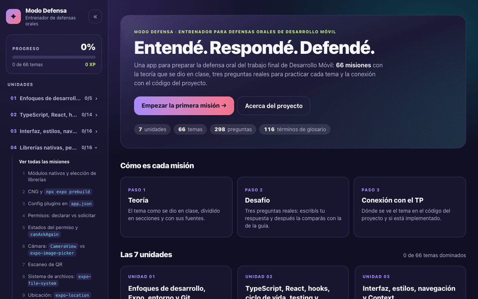

# mobile-trainer

App de estudio para preparar la defensa oral del trabajo final de **Desarrollo para Móviles** (UNER, 2026). El TP es "Reservas Deportivas", una app con React Native y Expo.

Dentro de la app se llama **Modo Defensa**. Cada tema es una misión de tres pasos:

1. **Teoría**: lo que se dio en clase, explicado y dividido en secciones (teoría, definiciones, comparaciones, errores comunes, lo que dijo el profe, código de ejemplo).
2. **Desafío**: tres preguntas reales de la guía de defensa. Escribís tu respuesta antes de mirar la de la guía (la versión para la Meet, la respuesta completa y la repregunta probable).
3. **Conexión con el TP**: dónde se ve el tema en el código de la app y si está implementado, en parte o no.



## Qué incluye

- **7 unidades y 66 temas**, con unas 21.000 palabras de teoría tomadas de las clases y del material.
- **Banco de 298 preguntas**, con búsqueda por palabra o por número (por ejemplo `9.15`) y filtros por bloque, prioridad y estado.
- **Lista "Para repasar"**, con las preguntas que marcaste para volver a ver.
- **Glosario de 116 términos**: aparecen subrayados en el texto y se pueden consultar al pasar el mouse o al tocarlos.
- **Menú lateral ocultable**, con el progreso, las unidades desplegables con sus temas y las herramientas.
- **Progreso guardado en el navegador**: temas dominados, respuestas escritas y XP.
- **Tema oscuro y claro**, y versión para celular.

## Tecnologías

| Parte | Herramienta |
| --- | --- |
| Interfaz | React 19 y TypeScript |
| Estilos | Tailwind CSS 4 |
| Empaquetado | Vite 8 |
| Paquetes | pnpm |

No usa librerías de rutas, de estado ni de Markdown: la navegación es por hash (`#/tema/u04-permisos-declarar-vs-solicitar`) y el texto se renderiza con un componente propio, sin HTML crudo.

## Cómo correrla

Necesitás Node 22.12 o superior y [pnpm](https://pnpm.io).

```bash
pnpm install
```

```bash
pnpm dev
```

Después abrí la dirección que muestra la terminal (normalmente `http://localhost:5173`).

| Comando | Qué hace |
| --- | --- |
| `pnpm dev` | Levanta la app en modo desarrollo |
| `pnpm build` | Revisa los tipos y genera la versión estática en `dist/` |
| `pnpm preview` | Sirve la versión de `dist/` |
| `pnpm validar` | Revisa que el contenido JSON sea coherente |

## Estructura

```
src/
├── data/            Todo el contenido, en JSON
├── types/           Tipos del contenido
├── lib/             Carga de datos, glosario y almacenamiento
├── hooks/           Progreso, rutas, tema visual y cargas
├── components/      Menú, teoría, desafío, respuestas, glosario
└── views/           Unidad, lección, banco de preguntas y glosario
scripts/
└── validar-contenido.mjs
```

## El contenido

Todo el texto vive en `src/data/`. El código solo lo muestra.

| Archivo | Qué tiene |
| --- | --- |
| `unidades.json` | Las 7 unidades y el orden de sus temas |
| `temas/U01.json` … `temas/U07.json` | Los 66 temas: resumen, explicación, pasos, definiciones, comparaciones, errores comunes, citas del profe, código de ejemplo, conexión con el TP y los ids de sus preguntas |
| `preguntas.json` | Las 298 preguntas de la guía de defensa, con todos sus campos |
| `glosario.json` | Los términos que se subrayan en el texto |

Los tipos de cada archivo están en `src/types/contenido.ts`. Después de editar un JSON, corré `pnpm validar`. Revisa, entre otras cosas, que cada tema tenga 3 preguntas de desafío y que todos los ids de preguntas existan.

El texto admite Markdown inline mínimo: `` `código` ``, `**negrita**` y `*cursiva*`. No se interpreta HTML.

## Seguridad de las dependencias

- Se instala con pnpm. En `pnpm-workspace.yaml` está configurado para no instalar versiones publicadas hace menos de 14 días (`minimumReleaseAge`) y para frenar cualquier script de instalación no aprobado (`strictDepBuilds`).
- Las versiones están fijadas en `package.json` y en `pnpm-lock.yaml`.
- Antes de agregar una dependencia, corré `pnpm audit`.

## Progreso

El progreso se guarda solo en tu navegador (`localStorage`). Si usaste la versión HTML anterior de Modo Defensa en el mismo navegador, los temas dominados se importan solos la primera vez.

## Aviso

Es material de estudio personal. El contenido sale de las clases, del material de la cátedra y de la guía de defensa del grupo, e incluye citas textuales de las clases.
