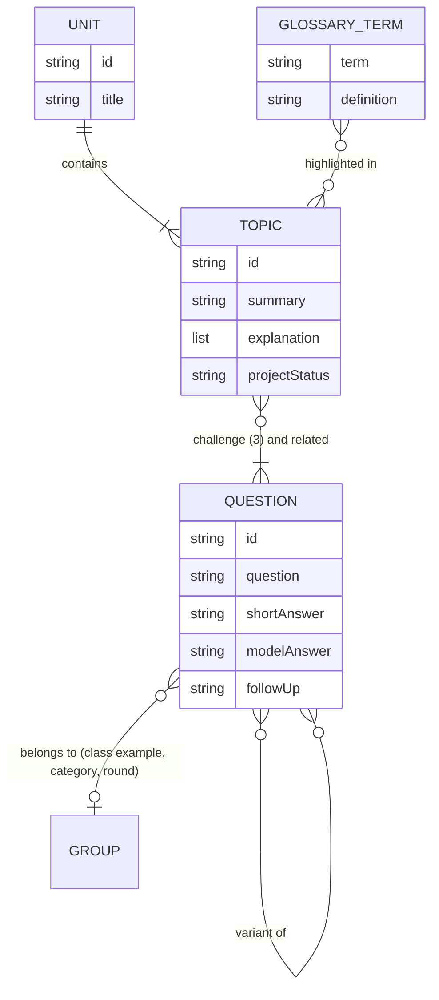

# Modo Defensa · mobile-trainer

A study app I built to prepare the oral defense of my final project in **Mobile Development** (UNER, Argentina, 2026). It turns 16 recorded classes, 19 course PDFs and a 298-question study guide into 66 short "missions" that you can practice like a game.

**Live demo:** [mobile-trainer-beta.vercel.app](https://mobile-trainer-beta.vercel.app/) · The interface is in Spanish, the language of the course.


## Why

The final project was a group mobile app ("Reservas Deportivas", built with React Native and Expo), and passing required an oral defense over video call. The professor can ask theory from any unit, ask you to explain a specific line of the project's code, or follow up on a technical decision. The material was spread across recordings, slides and a long Q&A document, so reviewing it was slow and passive.

## What it does

- **66 missions in 7 units.** Each mission has three steps:
  1. **Theory:** the topic as it was taught in class, split into sections (theory, step by step, definitions, comparisons, common mistakes, what the professor said, sample code) that you open one at a time from a side index.
  2. **Challenge:** three real questions from the guide. You write your answer first, then reveal a 30–60 second version to say out loud, the full model answer and the most likely follow-up question.
  3. **Connection to the project:** where the concept shows up in the group's code, and whether it is implemented, partial or missing.
- **Question bank** with all 298 questions, searchable by text or number and filterable by block, priority and status.
- **Review list** with the questions you marked as "need to review".
- **Glossary** of 116 terms, underlined inside the text, with a tooltip and an accessible dialog.
- **Progress, XP and answers** saved in the browser, with migration from the earlier HTML version.
- **Installable PWA** that works offline after the first visit, with light and dark themes and a mobile layout.

## How a mission works, and why

The challenge is built on **retrieval practice**: trying to recall an answer before seeing it improves long-term retention more than re-reading. That's why the app asks you to write something before it shows the answer, gives you a short version meant to be spoken (the defense is oral), and keeps the questions you struggled with in a separate list.

## Design decisions

- **All content lives in JSON, outside the code.** `src/data/` holds the units, the 66 topics, the 298 questions, the glossary and the project texts. Components only render it, so the content can be fixed without touching React.
- **Content is validated like code.** `pnpm validar` checks unique ids, that every question referenced by a topic exists, that each mission has exactly three challenge questions, that the figures shown on the home page match the data, and that no real person's name made it into the public content.
- **No router, state or Markdown libraries.** Navigation uses the URL hash (`#/tema/u04-permisos-declarar-vs-solicitar`), so every topic has a shareable link and it works on any static host. Progress uses a React Context. Text is rendered by a small inline-Markdown renderer that builds React elements and never injects raw HTML.
- **Lazy loading.** The theory of each unit and the question bank (about 850 kB) are loaded with dynamic `import()` only when needed, so the first screen stays light.
- **Accessibility.** Tabs with arrow-key navigation, dialogs that trap and return focus, `aria-live` announcements, labelled form fields, progress bars with ARIA roles, `prefers-reduced-motion` support, and no horizontal scrolling at 320 px.
- **PWA without a plugin.** A hand-written web manifest and service worker: cache-first for hashed assets, network-first for navigation with an offline fallback.
- **Supply-chain safety.** Nine direct dependencies (React and the build toolchain), all pinned to exact versions. pnpm refuses packages published less than 14 days ago (`minimumReleaseAge`) and blocks install scripts (`strictDepBuilds`). The lockfile was audited (`pnpm audit`) before the first install.

## Data model



The TypeScript types for every file are in [`src/types/contenido.ts`](src/types/contenido.ts).

## How the content was built

I used AI assistance (Claude) as part of the pipeline, and kept every step traceable:

1. **Class notes.** The class transcripts and course PDFs were processed into notes where each fact keeps its source: the minute of the recording or the page of the PDF.
2. **Question bank.** The 298 questions were extracted from my defense study guide with a script and compared word by word against the original document.
3. **Theory.** The theory of each topic was drafted from those notes with a strict rule: every statement cites its source, and nothing about the project's code may be claimed unless the code shows it. Known inaccuracies from class were corrected and flagged in a "notes on sources" section.
4. **Validation.** Everything is stored as JSON and checked by `pnpm validar` before each release.

## Tech stack

| Area | Tool |
| --- | --- |
| UI | React 19 |
| Language | TypeScript (strict) |
| Styles | Tailwind CSS 4 with design tokens for both themes |
| Build | Vite 8 |
| Package manager | pnpm |
| Hosting | Vercel |

## Run locally

Requires Node 22.12 or later and [pnpm](https://pnpm.io).

```bash
pnpm install
```

```bash
pnpm dev
```

| Command | What it does |
| --- | --- |
| `pnpm dev` | Starts the development server |
| `pnpm build` | Type-checks and builds the static site into `dist/` |
| `pnpm preview` | Serves the `dist/` build |
| `pnpm validar` | Validates the JSON content |

## Project structure

```
src/
├── data/          All content as JSON (units, topics, questions, glossary, project)
├── types/         Types for the content
├── lib/           Content loading, glossary matching, safe storage
├── hooks/         Progress, hash routing, theme and async loading
├── components/    Side menu, theory panel, challenge, answers, glossary
└── views/         Home, about, unit, lesson, question bank and glossary
public/            Icons, social preview image, web manifest and service worker
scripts/           Content validation
```

## Privacy and content

The names of the professor, classmates and teammates were replaced with generic references before publishing. Short quotes from classes and course materials are included for study purposes, each with its source. The fictional characters from the project brief (Emiliano, Marcelo, Nahuel) are kept.

## Author

**Andrea Junes** · [Portfolio](https://www.andreajunes.com/) · [GitHub](https://github.com/AndJunes) · [LinkedIn](https://www.linkedin.com/in/andrea-junes/)
